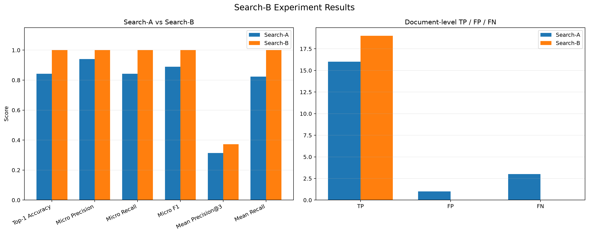
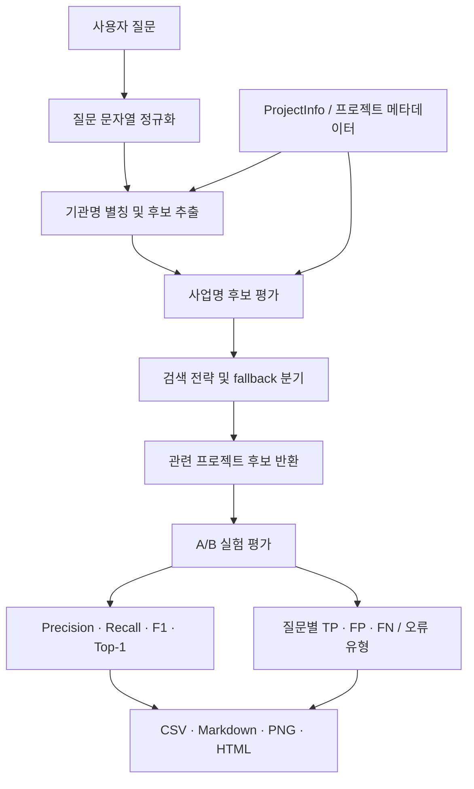

# BIDMATE — Search-B
### Project Retrieval & Evaluation Engineering

> 기관명·사업명 기반 프로젝트 검색의 후보 추출과 문서 선택 과정을 분석하고,
> 정규화 및 후보 탐색 로직을 개선한 뒤 벤치마크로 효과를 검증한 Search-B 기술 작업입니다.

<p align="center">
  
  
  
</p>

## 1. Executive Summary

Search-B의 핵심 과제는 사용자 질문과 프로젝트 메타데이터 사이에 존재하는 기관명·사업명 표기 차이를 처리하고, 질문 의도에 맞는 프로젝트 문서를 후보로 추출하는 것입니다.

2026-11-11에 수행한 벤치마크에서 100개 프로젝트와 20개 질문을 사용했습니다. 이 중 Q10은 후보 풀 진단 전용으로 분류하여 정량 평가에서 제외했고, 나머지 19개 질문을 평가했습니다.

| 지표 | Search-A (기존) | Search-B (개선) | 변화 |
|---|---:|---:|---:|
| Top-1 Accuracy | 84.2% | 100.0% | **+15.8%p** |
| Micro Precision | 94.1% | 100.0% | **+5.9%p** |
| Micro Recall | 84.2% | 100.0% | **+15.8%p** |
| Micro F1 | 88.9% | 100.0% | **+11.1%p** |
| TP / FP / FN | 16 / 1 / 3 | 19 / 0 / 0 | FP·FN 감소 |



**해석:** 평가 집합에서 Search-B는 Search-A 대비 재현율과 F1이 개선되었고, 집계된 FP와 FN이 모두 0으로 관측되었습니다. 단, 이는 19개 벤치마크 질문에 대한 결과이며 실제 운영 환경 전체의 정확도를 보장하지 않습니다.

## 2. 프로젝트 범위와 담당 영역

Search-B는 질문과 프로젝트 메타데이터를 비교하여 관련 프로젝트 문서를 선택하는 검색 단계입니다.

- 질문에서 기관명 및 사업명에 해당하는 표현을 식별합니다.
- 기관명 별칭과 표기 변형을 고려해 기관 후보를 추출합니다.
- 사업명과 질문의 핵심 표현을 비교해 프로젝트 후보를 평가합니다.
- 후보가 없거나 기관 매칭이 실패한 경우의 fallback 동작을 평가합니다.
- 실험 결과를 질문 단위로 저장하고 A/B 지표와 오류 유형을 비교합니다.

### 평가 범위

| 항목 | 값 |
|---|---:|
| 프로젝트 데이터 | 100개 |
| 벤치마크 질문 | 20개 |
| 정량 평가 질문 | 19개 |
| 진단 전용 질문 | 1개 (Q10) |
| 부정 질문 | 2개 (Q13, Q20) |
| 결과 CSV 행 | 20개 |

현재 `results.csv`에는 **20개 행**이 있습니다.

## 3. 검색 파이프라인



위 흐름은 Search-B의 논리적 처리 단계를 나타냅니다. 실제 함수 호출 순서와 세부 분기는 아래의 소스 코드 구조 및 구현을 기준으로 확인해야 합니다.

## 4. 코드 구조와 모듈 책임

| 경로 | 책임 | 주요 산출물 |
|---|---|---|
| `src/bidmate/retrieval/project_finder.py` | 운영 검색 로직 | 프로젝트 후보 및 검색 결과 |
| `scripts/evaluate_search_b_experiments.py` | A/B 실험 및 평가 | `results.csv`, `report.md` |
| `scripts/visualize_search_b_results.py` | 결과 시각화 | `search_b_comparison.png`, 실험 README |
| `scripts/build_search_b_team_report.py` | 팀 공유 자료 생성 | `TEAM_REPORT.md`, `team_dashboard.html` |
| `tests/test_project_finder.py` | 운영 검색 회귀 검증 | 검색 로직 테스트 |
| `tests/test_search_b_experiments.py` | 실험 로직 검증 | 평가·실험 테스트 |

### 실제 소스에서 발견한 클래스·함수

아래 목록은 README 생성 시점의 Python 소스 파일을 AST로 읽어 자동 추출합니다. 따라서 함수명이 변경되면 README를 다시 생성해 목록을 갱신할 수 있습니다.

### `src/bidmate/retrieval/project_finder.py`

운영 검색 모듈: 프로젝트 후보 탐색 및 검색 로직

- `_normalize(text)` — 유니코드 표현과 대소문자를 통일한다.
- `_tokenize(text)` — 한글, 영문, 숫자 단위로 단어를 추출한다.
- `_calculate_idf(projects)` — 사업명에 등장하는 단어의 역문서빈도(IDF)를 계산한다.
- `_weighted_coverage(query_tokens, matched_tokens, idf)` — 질문 단어 중 일치한 단어의 중요도 가중 비율을 계산한다.
- `find_project_ids(question, projects)` — 질문과 관련된 문서의 원본 project_id 목록을 반환한다.

### `scripts/evaluate_search_b_experiments.py`

실험 모듈: A/B 비교, 평가 데이터 처리, 지표 및 오류 분석

- `compact(value)` — 유니코드와 법인 표기를 정규화한 비교 문자열.
- `tokenize(value)` — 한국어·영문·숫자 기반 핵심 토큰.
- `get_agency_matches(question, projects)` — 질문에 명시된 기관을 데이터의 실제 기관명과 연결한다.
- `project_match_score(question, project_name)` — 질문 핵심 토큰이 사업명에 얼마나 포함되는지 계산한다.
- `run_experiment_b(question, projects, baseline_ids)` — 기관 후보 확장 실험.
- `resolve_expected_ids(case, projects)` — 사전에 정의한 정답 규칙을 실제 원본 project_id로 변환한다.
- `calculate_metrics(expected, returned, k)` — 정답 문서와 검색 결과를 비교한다.
- `classify_issue(expected, returned, resolved, evaluation_type)`
- `evaluate(projects)`
- `summarize(rows, prefix)` — 긍정 질문과 부정 질문을 분리해 평가 지표를 계산한다.
- `write_csv(rows, path)`
- `write_report(rows, path, project_count)`
- `main()`

### `scripts/visualize_search_b_results.py`

시각화 모듈: 실험 결과 그래프 및 실험 안내 문서 생성

- 최상위 클래스/함수 정의를 찾지 못했습니다.

### `scripts/build_search_b_team_report.py`

공유 자료 생성 모듈: 팀 보고서와 HTML 대시보드 생성

- `esc(value)`
- `read_results()`
- `clean_ids(value)`
- `metric_cards()`
- `comparison_chart()`
- `count_chart()`
- `result_table(rows)`
- `check_table()`
- `build_html(rows)`
- `build_markdown(rows)`
- `main()`

### `tests/test_project_finder.py`

운영 검색 로직의 회귀 테스트

- `projects()`
- `test_find_project_ids(projects, question, expected)`

### `tests/test_search_b_experiments.py`

실험·평가 로직의 테스트

- `test_positive_question_metrics()`
- `test_negative_question_with_no_result_is_correct()`
- `test_negative_question_with_result_is_false_positive()`
- `test_precision_at_k_uses_fixed_k()`
- `test_invalid_k_raises_error()`
- `test_summary_separates_positive_and_negative_questions()`
- `test_unresolved_and_agency_pool_are_excluded()`
- `test_empty_dataset_returns_zero_metrics()`
- `test_compact_removes_legal_entity_suffix()`
- `test_q05_agency_is_detected_despite_legal_suffix()`
- `test_q05_search_returns_correct_agency_project()`


## 5. 실험 설계 및 평가 방법

### 비교 대상

- **Search-A:** 기존 검색 방식. 비교 기준선(baseline)으로 사용합니다.
- **Search-B:** 기관 후보 확장 및 기관·사업명 기반 후보 평가를 적용한 방식입니다.

### 평가 지표

| 지표 | 의미 | 해석 |
|---|---|---|
| Top-1 Accuracy | 첫 번째 검색 결과가 정답인지 평가 | 최상위 결과의 정확성 |
| Micro Precision | 반환 후보 중 정답 후보의 비율 | 오검색 억제 |
| Micro Recall | 정답 후보 중 검색된 비율 | 정답 누락 억제 |
| Micro F1 | Precision과 Recall의 조화평균 | 두 지표의 균형 |
| TP | 정답으로 검색된 항목 | 올바른 검색 |
| FP | 정답이 아닌데 검색된 항목 | 오검색 |
| FN | 정답이어야 하지만 검색되지 않은 항목 | 미검색 |

정밀도와 재현율은 각각 다음과 같이 정의합니다.

\[
Precision = \frac{TP}{TP + FP}
\qquad
Recall = \frac{TP}{TP + FN}
\]

\[
F1 = 2 \times \frac{Precision \times Recall}{Precision + Recall}
\]

### 평가 데이터 해석 시 주의사항

- 전체 질문 20개 중 Q10은 `AGENCY_POOL_DIAGNOSTIC` 진단 전용이므로 정량 평가에서 제외했습니다.
- Q13과 Q20은 정답 프로젝트가 없는 부정 질문으로 구성했습니다.
- 부정 질문은 검색 결과를 무조건 반환하는지 여부를 점검하는 데 사용합니다.
- 평가 질문 수가 작으므로 100% 결과를 일반화하거나 운영 정확도로 해석해서는 안 됩니다.

## 6. 오류 분석 및 근본 원인: Q05

### 현상

질문: **인천공항운영서비스 차세대 ERP 시스템 구축**

기대 문서의 기관명과 사업명에는 법인 표기가 포함되어 있었지만 질문에는 법인 표기가 생략되어 있었습니다.

| 구분 | 실제 표기 |
|---|---|
| 질문 기관명 | `인천공항운영서비스` |
| 데이터 기관명 | `인천공항운영서비스(주)` |
| 사업명 내 기관 표기 | `인천공항운영서비스㈜` |

### 근본 원인 (Root Cause)

기존 실험 코드의 `compact()`는 괄호와 특수문자를 제거했지만, 법인 접미사인 `주` 자체를 제거하지 못했습니다. 그 결과 질문과 데이터의 비교 문자열이 동일해지지 않았고, 기관 후보 추출이 실패했습니다.

이후 기관 후보가 비어 있는 상황에서 `NO_AGENCY_USE_A` fallback이 실행되어, 질문과 무관한 한국가스공사 ERP 문서가 반환되었습니다.

```text
질문: 인천공항운영서비스
          │
          ▼
기존 compact 처리
          │
          ├─ 질문: 인천공항운영서비스
          └─ 데이터: 인천공항운영서비스주
                         │
                         ▼
                 기관 후보 매칭 실패
                         │
                         ▼
              NO_AGENCY_USE_A fallback
                         │
                         ▼
             한국가스공사 ERP 문서 오검색
```

### 수정 사항

실험 코드의 `compact()`에 다음 처리를 반영했습니다.

1. `unicodedata.normalize("NFKC", ...)`를 적용해 호환 유니코드 표기를 정규화합니다.
2. `(주)`, `(사)`, `주식회사`, `유한회사` 등 확인된 법인 표기를 비교 전에 제거합니다.
3. 한글·영문·숫자 외의 문자를 제거해 비교 문자열을 생성합니다.
4. 질문과 데이터의 기관명 비교가 동일한 정규화 규칙을 따르도록 합니다.

개선된 정규화 함수의 핵심은 다음과 같습니다.

```python
def compact(value: str) -> str:
    normalized = unicodedata.normalize(
        "NFKC",
        str(value),
    ).casefold().strip()

    legal_suffixes = (
        "(주)",
        "(사)",
        "주식회사",
        "유한회사",
    )

    for suffix in legal_suffixes:
        if normalized.endswith(suffix):
            normalized = normalized[:-len(suffix)].strip()
            break

    return re.sub(r"[^가-힣a-z0-9]", "", normalized)
```

예를 들어 `인천공항운영서비스(주)`와 `인천공항운영서비스㈜`는 NFKC 정규화 및 법인 표기 제거 후 동일한 비교 문자열로 처리됩니다.

### 수정 전후 검증

| 항목 | 수정 전 B | 수정 후 B |
|---|---|---|
| 기관 후보 추출 | 실패 | 성공 |
| 선택 전략 | `NO_AGENCY_USE_A` | `AGENCY_AND_PROJECT` |
| Top-1 결과 | 한국가스공사 ERP | 인천공항운영서비스 ERP |
| 오류 유형 | `WRONG_DOCUMENT` | `EXACT_MATCH` |
| FP / FN | 1 / 1 | 0 / 0 |

Q05에서 확인된 개선은 단순한 문자열 처리 변경에 그치지 않습니다. 기관 후보 추출 실패가 fallback 경로로 전파되어 오검색을 일으키는 연결 관계를 확인하고, 입력 정규화 단계에서 해당 원인을 제거한 사례입니다.

## 7. A/B 실험 결과

| 지표 | Search-A | Search-B | 변화 |
|---|---:|---:|---:|
| Top-1 Accuracy | 84.2% | 100.0% | +15.8%p |
| Micro Precision | 94.1% | 100.0% | +5.9%p |
| Micro Recall | 84.2% | 100.0% | +15.8%p |
| Micro F1 | 88.9% | 100.0% | +11.1%p |
| TP | 16 | 19 | +3 |
| FP | 1 | 0 | -1 |
| FN | 3 | 0 | -3 |

### 오류 건수 비교

| 오류 유형 | Search-A | Search-B |
|---|---:|---:|
| False Positive | 1 | 0 |
| False Negative | 3 | 0 |

**결과 해석**

- Recall이 84.2%에서 100.0%로 증가했습니다. 벤치마크에서 정답 후보 누락이 줄어든 결과입니다.
- Precision이 94.1%에서 100.0%로 증가했습니다. 평가 집합에서 오답 후보가 관측되지 않았습니다.
- F1은 88.9%에서 100.0%로 증가했습니다.
- FP와 FN은 각각 1건과 3건에서 0건으로 감소했습니다.

이는 해당 평가 집합에서 관측된 결과입니다. 후보 확장으로 인해 전체 데이터에서 항상 오검색이 감소한다고 단정할 수는 없으며, 더 큰 데이터와 다양한 부정 질문으로 추가 검증해야 합니다.

## 8. 질문별 결과 및 사례 분석

질문별 상세 결과는 원본 CSV를 기준으로 확인합니다.

- [results.csv](reports/search_b_experiment/results.csv) — 질문별 A/B 결과, 정답 ID, 오류 유형 및 평가 정보
- [report.md](reports/search_b_experiment/report.md) — 집계 지표 및 실험 요약
- [TEAM_REPORT.md](reports/search_b_experiment/TEAM_REPORT.md) — 팀 공유용 상세 분석

### 주요 질문

| 질문 ID | 질문/유형 | 평가상 의미 |
|---|---|---|
| Q05 | 인천공항운영서비스 차세대 ERP 시스템 구축 | 법인 표기 정규화 실패 및 fallback 오검색 수정 사례 |
| Q10 | 한국수자원공사 시스템 구축 | `AGENCY_POOL_DIAGNOSTIC` 진단 전용, 정량 평가 제외 |
| Q13 | 삼성전자 스마트폰 개발 사업 | 정답이 없는 부정 질문 |
| Q20 | 삼성전자 스마트폰 개발 사업 예산 | 정답이 없는 부정 질문 |

Q13과 Q20의 부정 질문 결과는 단순히 후보를 많이 반환하는 방식이 아니라, 관련성이 없는 질문에서 검색 결과를 어떻게 제어하는지 검토하는 데 중요합니다.

## 9. 테스트 및 품질 검증

2026-11-11 실행 결과:

| 검증 항목 | 명령 | 결과 |
|---|---|---:|
| 전체 테스트 | `uv run pytest -q` | **21 passed** |
| Search-B 및 운영 검색 테스트 | `uv run pytest tests/test_search_b_experiments.py tests/test_project_finder.py -q` | **20 passed** |
| Ruff 정적 검사 | `uv run ruff check scripts/evaluate_search_b_experiments.py tests/test_search_b_experiments.py` | **통과** |

테스트 통과는 테스트에 포함된 동작이 검증되었다는 의미입니다. 대규모 운영 데이터, 동시 요청, 검색 지연 시간, 장기적인 데이터 분포 변화까지 검증했다는 의미는 아닙니다.

## 10. 실험 재현 방법

저장소 루트에서 실행합니다.

```bash
# 1. 의존성 및 프로젝트 환경 확인
uv sync

# 2. A/B 평가 실행
uv run python scripts/evaluate_search_b_experiments.py

# 3. 성능 그래프 및 실험 README 생성
uv run --with matplotlib python scripts/visualize_search_b_results.py

# 4. 팀 보고서 및 HTML 대시보드 생성
uv run python scripts/build_search_b_team_report.py

# 5. 전체 테스트
uv run pytest -q

# 6. 코드 품질 검사
uv run ruff check .
```

> 데이터 파일 `../data_list.csv`가 필요한 구성이라면 프로젝트가 기대하는 상대 경로에 데이터 파일을 준비해야 합니다. 원본 데이터의 접근 권한과 저장소 공개 가능 여부를 확인하고, 민감하거나 공개가 허용되지 않은 데이터는 Git에 포함하지 마세요.

## 11. 산출물

- [상세 팀 기술 보고서](reports/search_b_experiment/TEAM_REPORT.md)
- [실험 결과 보고서](reports/search_b_experiment/report.md)
- [실험 산출물 안내](reports/search_b_experiment/README.md)
- [질문별 원본 결과 CSV](reports/search_b_experiment/results.csv)
- [A/B 성능 비교 그래프](reports/search_b_experiment/search_b_comparison.png)
- [인터랙티브 HTML 대시보드](reports/search_b_experiment/team_dashboard.html)

## 12. 한계 및 향후 개선 방향

현재 결과는 제한된 벤치마크에 대한 검증입니다. 다음 항목을 후속 과제로 둡니다.

| 우선순위 | 개선 과제 | 필요한 이유 | 검증 방법 |
|---|---|---|---|
| P0 | 평가 질문 및 정답 데이터 확대 | 19개 질문만으로 일반화 성능을 보장할 수 없음 | 기관·사업·부정 질문 유형별 테스트셋 확장 |
| P0 | 법인 표기 및 기관 별칭 사전 확장 | 표기 변형이 늘어날 때 정규화 누락 가능 | 변형 케이스 단위 회귀 테스트 |
| P1 | 후보 확장에 따른 오검색 모니터링 | Recall 개선과 함께 FP가 증가할 가능성 | Precision/Recall 및 FP/FN 동시 측정 |
| P1 | fallback 정책 세분화 | 기관 후보가 없을 때 무관한 문서가 선택될 위험 | fallback 유형별 성공률·오류율 측정 |
| P1 | Top-k 및 순위 품질 평가 | Top-1 외 후보 순위 품질 확인 필요 | MRR, Recall@k, nDCG 등 추가 |
| P2 | 검색 지연 시간 및 처리량 측정 | 정확도 외 운영 성능 검증 필요 | p50/p95 latency, throughput 측정 |
| P2 | 데이터 변경에 대한 회귀 평가 자동화 | 데이터 갱신 후 성능 퇴행 방지 | CI 기반 벤치마크 및 임계값 검사 |

## 13. 기술적 결론

이번 작업에서 확인한 핵심은 검색 품질이 사업명 유사도만으로 결정되지 않는다는 점입니다. 기관명 정규화와 후보 추출 단계에서 발생한 작은 표기 차이가 후속 검색 전략과 fallback 동작에 영향을 주어 최종 문서 오검색으로 이어질 수 있었습니다.

Q05 분석을 통해 해당 연결 관계를 확인하고 법인 표기 정규화를 개선했습니다. 이후 수행한 19개 질문 벤치마크에서 Search-B는 Search-A 대비 Top-1 Accuracy, Precision, Recall, F1이 모두 개선된 결과를 보였습니다.

다만 이 결과는 현재 벤치마크 범위 내의 관측값입니다. 다음 단계에서는 더 큰 평가 데이터셋, 다양한 기관명 표기 변형, 부정 질문, 순위 평가 및 운영 성능 측정을 추가하여 검색 시스템의 신뢰도를 검증해야 합니다.

---

<sub>Generated by `scripts/build_search_b_readme.py` · Benchmark snapshot: 2026-11-11</sub>
